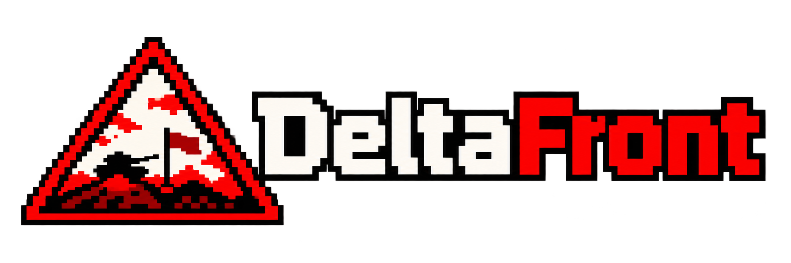

<p align="center">
  
</p>

**DeltaFront** is a fast-paced multiplayer strategy game where players battle for territory, build their nations, form alliances, and dominate the front.

DeltaFront is an independent fork of [OpenFront](https://github.com/openfrontio/OpenFrontIO) (itself a fork/rewrite of [WarFront.io](https://github.com/WarFrontIO)). It is not affiliated with or endorsed by OpenFront Inc.

[](https://www.gnu.org/licenses/agpl-3.0)
[](https://creativecommons.org/licenses/by-sa/4.0/)

## License and attribution

DeltaFront's source code is licensed under the **GNU Affero General Public License v3.0**, inherited from OpenFront.

The upstream license's additional terms (AGPL §7) apply to DeltaFront:

- The notice **"© OpenFront and Contributors"** must stay in reasonably visible places. DeltaFront shows it in the footer and on the game-starting screen.
- A modified version must not misrepresent its origin or use "OpenFront" as its title. DeltaFront shows a "Based on OpenFront" notice in the footer.
- Players of a network deployment must be offered the corresponding source (AGPL §13). The footer's GitHub link is that offer. Point `BRAND.sourceRepoUrl` in `src/client/Branding.ts` at the DeltaFront repository.

See [LICENSE](LICENSE), [LICENSE-ASSETS](LICENSE-ASSETS) and [LICENSING.md](LICENSING.md) (upstream license history), and [CREDITS.md](CREDITS.md).

Upstream also keeps a `proprietary/` folder of All Rights Reserved OpenFront assets (logo, display font, music). DeltaFront does **not** include, build or ship it. Its music is therefore absent: add your own tracks at `resources/sounds/music/menu-theme.mp3`, `resources/sounds/music/gameplay.mp3` and `resources/sounds/effects/game-start-alert.mp3` (missing audio fails silently).

## Prerequisites

- [Node.js](https://nodejs.org/) v24.15.0 or newer in the Node 24 release line
- [npm](https://www.npmjs.com/) v12.1.0 or newer in the npm 12 release line
- A modern web browser

Node.js may bundle an older npm version. Upgrade it before installing project dependencies:

```bash
npm install --global --ignore-scripts npm@12.1.0
```

## Installation

```bash
git clone DeltaFront repository URL < your > DeltaFront
cd DeltaFront
npm run inst
```

Use `npm run inst`, not `npm install`. It runs `npm ci --ignore-scripts`, which installs exactly the versions in `package-lock.json` without running lifecycle scripts. `.npmrc` also rejects dependency releases less than seven days old and dependencies from Git, remote URLs, tarballs or directories.

## Running the game

```bash
npm run dev              # client (http://localhost:9000) + game server, hot reload
npm run start:client     # client only
npm run start:server-dev # game server only
```

Set `SKIP_BROWSER_OPEN=true` to stop `npm run dev` opening a browser.

Single-player, private lobbies and public lobbies run entirely on the local server. Accounts, stats, the store, clans and leaderboards come from a separate account API (`api.<DOMAIN>`), which is closed source upstream and not part of this repository. In dev the client looks for it at `http://localhost:8787`, so those features are unavailable locally and `ECONNREFUSED` lines in the server log are expected.

## Configuration

Production servers read their settings from environment variables; see [example.env](example.env). Optional DeltaFront-specific ones:

| Variable                     | Purpose                                                 |
| ---------------------------- | ------------------------------------------------------- |
| `GOOGLE_ANALYTICS_ID`        | GA4 measurement ID (`G-…`). Unset: no Google Analytics. |
| `CLOUDFLARE_ANALYTICS_TOKEN` | Cloudflare Web Analytics token. Unset: no beacon.       |

Product name, community links (Discord, Reddit, wiki), the source-code link, the Steam app ID, the tutorial video and the ads switch live in [`src/client/Branding.ts`](src/client/Branding.ts). A link left empty hides the UI that would use it.

### Account backend features

OpenFront's account API (sign-in, store, clans, ranked, leaderboards) is closed source and not part of this repository, so DeltaFront ships with those features **off** and their UI hidden. Solo, private and public lobbies and the simulation do not need it. The switches are in [`packages/shared/src/AccountFeatures.ts`](packages/shared/src/AccountFeatures.ts); what each needs, and the two decisions before a public deployment, are in [docs/DeltaFrontServices.md](docs/DeltaFrontServices.md).

## Branding and theme

- Logo and icon: `resources/images/branding/` (see the README there).
- Colours, radii and shared button/input/panel classes: the `@theme` and `@layer components` blocks in [`src/client/styles.css`](src/client/styles.css), with tokens named `--color-df-*`.
- Display font: Pixelify Sans (SIL OFL 1.1), in `resources/fonts/pixelify-sans/`.

## Development tools

```bash
npm run format # Prettier
npm run lint   # Oxlint + ESLint
npm run lint:fix
npm run typecheck  # tsc for the root project and every package
npm test           # Vitest
npm run build-prod # production build into static/
```

## Project structure

- `/src/client` - Frontend game client (Lit + Tailwind UI, WebGL2 renderer)
- `/src/server` - Backend game server (Express + ws)
- `/packages/engine` - Deterministic game simulation (`@openfront/engine`)
- `/packages/engine-api` - The engine's contract: types, schemas, game updates and the worker protocol (`@openfront/engine-api`)
- `/packages/engine-lib` - Engine code also used outside the engine: map grid, rules, helpers (`@openfront/engine-lib`)
- `/packages/shared` - Code shared by client and server: wire schemas, env, asset URLs (`@openfront/shared`)
- `/packages/zbin` - Compact binary wire format for zod schemas
- `/resources` - Open assets (CC BY-SA 4.0): images, maps, sounds, translations

The `@openfront/*` workspace package names are internal import paths kept from upstream so upstream changes keep merging cleanly.
